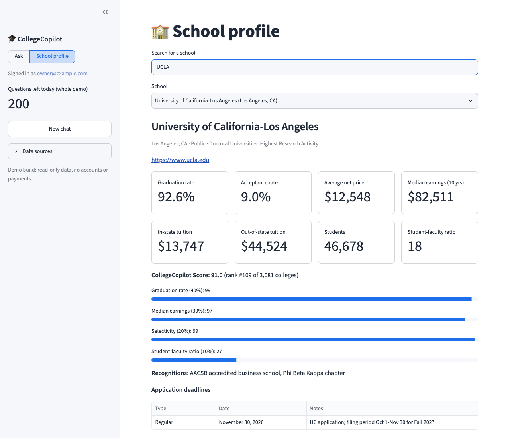
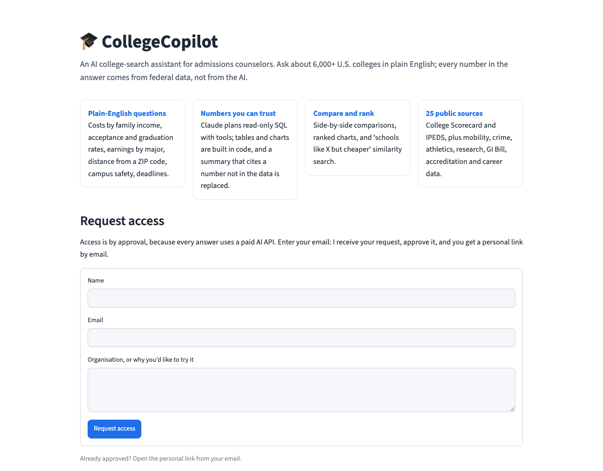
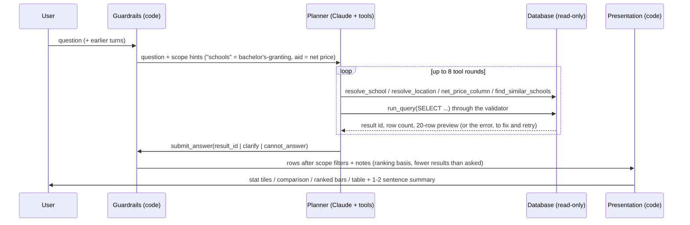
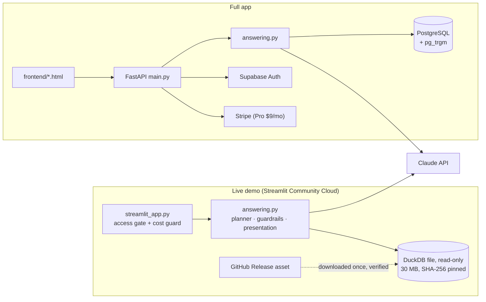

# CollegeCopilot

[](https://github.com/Gunar-Oguz/College-Copilot/actions/workflows/ci.yml)


An AI college-search assistant for admissions counselors. You ask about U.S. colleges in plain
English ("What would MIT cost for a family making $150,000?") and get an answer built from federal
data: stat tiles, comparison tables, ranked charts and a one-sentence summary. **The numbers never
come from the model.** Claude plans read-only SQL through a small set of tools, and code formats
every number from the result rows.

### [▶ Open the live app](https://college-copilot-gulnar.streamlit.app)

> **Access is by approval:** enter your email on the app, I receive a request and approve it, and
> you get a personal link by email. This protects the paid AI API behind every answer.

| Ask in plain English | School profile | Access request |
|---|---|---|
| _screenshot pending_ |  |  |

## Features

- **Questions in plain English** about 6,273 institutions: cost by family income, acceptance,
  graduation and retention rates, earnings (overall and by major), debt, distance from a ZIP code
  or city, campus safety, athletics, research spending, accreditation, application deadlines.
- **Comparisons and rankings**: side-by-side tables with the better value marked, ranked bar charts,
  and "schools like X but easier to get into / cheaper / in these states" similarity search.
- **Follow-up questions** ("only the public ones", "and in Texas?") reuse the earlier turns.
- **Clarifying questions** when a name is ambiguous ("UW": Washington or Wisconsin?), quick replies
  for vague questions, and honest "I don't know" answers with what *is* known about the school.
- **CollegeCopilot Score**: a transparent ranking of about 3,100 degree-granting colleges.
- **25 public data sources** (College Scorecard, IPEDS and others); every table and column is
  documented in [docs/DATA_SOURCES.md](docs/DATA_SOURCES.md).

## How the AI answers



1. **Planner** (`backend/planner.py`): Claude (Haiku 4.5) reads the question and calls tools. It
   never states facts itself; it finishes by submitting the *id* of a tool result.
   - `resolve_school`: name or nickname → school ids and coordinates (asks which one if ambiguous)
   - `resolve_location`: ZIP code or city → coordinates, used with the `miles_between()` SQL function
   - `net_price_column`: family income → the right net-price bracket
   - `find_similar_schools`: "schools like X" with optional easier / cheaper / state filters
   - `run_query`: one read-only `SELECT`, validated, with a 5-second timeout and a 500-row cap
   - `submit_answer`: a tool result, a clarifying question, or "can't answer"
2. **Guardrails** (`backend/guardrails.py`): decided in code, not left to the model (see below).
3. **Presentation** (`backend/presentation.py`): rows become stat tiles, a comparison table, ranked
   bars or a table. Every number shown is formatted from the data. Claude writes only a one- or
   two-sentence summary, and the summary is **replaced by a plain one if it cites any number that is
   not in the rows**.

## Architecture



The same `answering.py` pipeline runs in both. `backend/database.py` chooses the backend
(`DB_BACKEND`, or `DUCKDB_PATH` for DuckDB); application SQL is written once with psycopg2
placeholders and translated for DuckDB.

## Evaluation

Two suites call the real model: `evals/run_eval.py` (70 questions with ground-truth SQL: lookups,
rankings, counts, net price by income, comparisons, aggregates, majors, trends, ambiguous names,
similar schools, ZIP/city distance, the extra sources, and questions it must refuse) and
`backend/evals.py` (30 end-to-end behavior checks). The ground truth always comes from PostgreSQL;
`--backend duckdb` runs the planner on the demo database, so the two backends are compared on the
same questions and the same truth.

**Backend parity, measured 2026-11-09** (no model involved):

| Check | Result |
|---|---|
| Ground-truth queries returning identical rows on PostgreSQL and DuckDB | **56 / 56** |
| `resolve_school` on 379 names, nicknames and misspellings: same ids and scores | **376 / 379** (the 3 differ only in the order of exactly tied candidates, which PostgreSQL leaves undefined) |
| `resolve_location` on ZIP codes and cities | **10 / 10** |
| Planner system prompt | identical except one dropped column (`programs.id`) |

**Model evals (pass rate by backend):** _pending_. The run needs a valid `ANTHROPIC_API_KEY`;
the command is `python evals/run_eval.py --backend postgres` and
`python evals/run_eval.py --backend duckdb --duckdb-path <file>` (about $1 per run with prompt
caching; the runner prints the token count and cost).

## Security

- **Read-only SQL, three layers.** The validator allows one `SELECT`/`WITH` statement, strips
  comments and blocks file and network functions (`pg_*`, `dblink`, `COPY`, `INTO`, DuckDB's
  `read_*`, `glob`, `query()`, `ATTACH`, `INSTALL`, `PRAGMA`), user tables (`user_*`) and log and
  billing tables. PostgreSQL then runs it in a read-only transaction; DuckDB opens the file with
  `read_only=True` and `enable_external_access=false`, so even a query that slipped past the
  validator cannot write or read a file.
- **Timeout and row cap.** 5 seconds (`statement_timeout` on PostgreSQL, a watchdog thread calling
  `interrupt()` on DuckDB) and at most 500 rows.
- **No private data in the demo.** The export copies only public tables; user, review, log and
  billing tables never leave PostgreSQL.
- **Signed access links.** Approve and access links are HMAC-SHA256 tokens (URL-safe base64) with a
  purpose, an expiry (7 and 30 days) and the visitor's email; verified with constant-time comparison.
  Approving needs a button press, so email link scanners cannot approve by opening the link. The
  request form gives the same reply whatever happens, is rate-limited per session and globally, and
  never reveals whether an email was approved.
- **Cost caps.** 20 questions per visitor per UTC day and 200 per day for the whole demo (both
  configurable). Questions answered without the AI are not counted.
- **Verified data.** The demo downloads the database once and checks its SHA-256 against
  [data/duckdb_manifest.json](data/duckdb_manifest.json) before opening it.

## Tests and CI

```bash
pip install -r requirements-dev.txt
ruff check .
python -m pytest            # 308 tests; PostgreSQL tests skip when no database is reachable
```

- DuckDB backend tests run on a tiny synthetic database built in a temporary folder
  (`tests/conftest.py`): query runner, validator rules, timeout, `miles_between()`, PostgreSQL-like
  division and NULL order, the Python pg_trgm matcher (checked against PostgreSQL's values), lookups,
  similar schools, guardrails and school profiles.
- Access gate (sign/verify, tampering, expiry, wrong purpose, emails, SMTP over TLS), cost guard
  (limits, UTC rollover, thread safety) and the data download (hash check, cache, corrupt cache).
- Streamlit `AppTest` smoke tests: the gate, a valid link opening the chat, an answer rendered as
  stat tiles, follow-ups, limits, the request and approve flow, owner passcode, school profile.
  The answer pipeline is replaced by a fake, so tests make no API or network calls.
- GitHub Actions ([ci.yml](.github/workflows/ci.yml)) runs ruff and pytest on Python 3.11 and 3.13.

## Design decisions and trade-offs

- **DuckDB for the demo.** A free host has no PostgreSQL. All 25 sources plus ten years of
  programs fit in a 30 MB DuckDB file (from 431 MB in PostgreSQL), which loads in seconds and needs
  no server. The cost is a dialect gap, closed in `database.py` rather than in the prompt: integer
  division and NULL ordering are set to PostgreSQL's behavior, `::numeric` casts become `DOUBLE`
  (DuckDB's `NUMERIC` would round to 3 decimals), `miles_between()` is a macro, and pg_trgm name
  matching runs in Python. The model writes the same SQL on both backends.
- **Stateless signed tokens instead of a user table.** Streamlit Community Cloud has no durable
  storage. Signed links need no database, survive restarts, and are revoked all at once by changing
  `ACCESS_SECRET`. The trade-off: one link cannot be revoked alone (links expire after 30 days).
- **Gated access.** Every answer costs two Claude calls. Approval keeps a public portfolio link from
  becoming an open, paid API; the per-visitor and daily caps are the second line.
- **In-memory limits.** Counters reset when the app restarts, which is acceptable for a demo; the
  full app keeps usage in PostgreSQL with an atomic check-and-increment.
- **Haiku for planning.** Planning is tool calls and short SQL, so the fast, inexpensive model is
  enough; the prompt (schema plus notes, about 15k tokens) is cached across questions.

## Run locally

**Demo (Streamlit + DuckDB):**

```bash
pip install -r requirements.txt
cp .streamlit/secrets.toml.example .streamlit/secrets.toml   # add your ANTHROPIC_API_KEY
python scripts/export_duckdb.py --out ~/collegecopilot.duckdb  # needs the PostgreSQL data
DUCKDB_PATH=~/collegecopilot.duckdb streamlit run streamlit_app.py
```

Without `DUCKDB_PATH` the app downloads the published file. For local development,
`ACCESS_GATE = "off"` skips the gate and `DEV_PRINT_LINKS = true` writes approve and access links to
the server log instead of emailing them. `python scripts/issue_access_link.py you@example.com
--secrets .streamlit/secrets.toml` prints a personal link directly.

**Deploy on Streamlit Community Cloud:** main file `streamlit_app.py`, Python 3.13, and paste the
secrets from `.streamlit/secrets.toml.example` (Claude key, `ACCESS_SECRET`, owner email and
passcode, Gmail SMTP app password, `APP_URL`, limits).

**Full app (FastAPI + PostgreSQL):** see the setup below.

## Project structure

```
College-Copilot/
├── streamlit_app.py           # Live demo: access gate, chat, school profile
├── backend/
│   ├── main.py                # FastAPI app: /ask, accounts, billing, pages
│   ├── answering.py           # One question → answer (shared by both apps)
│   ├── planner.py             # Claude tool-use planner
│   ├── guardrails.py          # Scope, ranking and "fewer results" rules
│   ├── presentation.py        # Result rows → display blocks; summary number check
│   ├── database.py            # PostgreSQL / DuckDB, validator, read-only runner
│   ├── school_lookup.py       # School name/alias resolution (pg_trgm or Python)
│   ├── locations.py           # ZIP/city → coordinates
│   ├── similar_schools.py     # Similarity search
│   ├── school_profile.py      # Profiles, compare tool, "I don't know" fallbacks
│   ├── access.py              # Signed approve/access links, emails (demo)
│   ├── cost_guard.py          # Question limits (demo)
│   ├── demo_data.py           # Download and verify the DuckDB file (demo)
│   ├── plans.py, billing.py   # Free/Pro plans and Stripe (full app)
│   ├── user_data.py           # Supabase auth, saved schools, notes, reviews (full app)
│   └── load_*.py              # Data loaders
├── scripts/
│   ├── export_duckdb.py       # PostgreSQL → DuckDB demo file
│   └── issue_access_link.py   # Print a personal access link
├── data/                      # Schema SQL, curated aliases, duckdb_manifest.json
├── docs/                      # DATA_SOURCES.md, screenshots
├── evals/                     # Question set with known answers + scorer
├── frontend/                  # Full app pages (landing, chat, school, compare, pricing)
└── tests/
```

## Data sources

The core `schools` and `programs` tables come from the U.S. Department of Education
**College Scorecard** (2015-16 to 2024-25). The other sources, each loaded by its own script: **IPEDS**
(NCES), **Opportunity Insights** mobility, **Clery Act** campus crime, federal **cohort default
rates**, **EADA** athletics, **NSF HERD** research spending, the **VA GI Bill** Comparison Tool,
**DAPIP** accreditation, **IRS Form 990** via ProPublica, **BLS** wages and projections with
**O*NET**, **Census ACS** demographics, **AACSB / Phi Beta Kappa / CTCL / QuestBridge / Posse**
lists, and **Common App** deadlines. Every table and column: [docs/DATA_SOURCES.md](docs/DATA_SOURCES.md).

## Full app setup (FastAPI + PostgreSQL)

### 1. Environment variables (`.env`)

```
ANTHROPIC_API_KEY=your_key
COLLEGE_SCORECARD_API_KEY=your_key
SUPABASE_URL=https://your-project.supabase.co      # optional: accounts and saved schools
SUPABASE_ANON_KEY=your_publishable_key
STRIPE_SECRET_KEY=rk_test_...                       # optional: Pro subscriptions (see "Plans and payments")
STRIPE_PUBLISHABLE_KEY=pk_test_...
STRIPE_WEBHOOK_SECRET=whsec_...
```

### 2. Install dependencies

```bash
cd backend
python3 -m venv venv
source venv/bin/activate
pip install -r requirements.txt
```

### 3. Load data (from `backend/`)

```bash
python load_all_years.py --recreate --start-year 2015 --end-year 2024
python load_programs.py --recreate
python load_aliases.py        # school nicknames; run after schools load
python load_zipcodes.py       # school coordinates + distance search; rerun after reloading schools
```

Extra public sources (optional; `pip install -r requirements-data.txt` first). Each loader downloads
its files to `data/<source>/`, replaces its tables and records itself in `data_sources`. Run
`load_ipeds.py` first: the others use its directory file to map OPEIDs and ZIPs to schools.

```bash
python load_ipeds.py          # IPEDS: admissions, enrollment by race/gender, costs, finance, faculty, outcomes
python load_mobility.py       # Opportunity Insights economic mobility
python load_campus_safety.py  # Clery Act crime statistics
python load_default_rates.py  # Federal student loan cohort default rates
python load_athletics.py      # EADA / Title IX athletics
python load_research.py       # NSF HERD research spending
python load_gi_bill.py        # VA GI Bill Comparison Tool
python load_accreditation.py  # DAPIP institutional and program accreditation
python load_irs990.py         # IRS Form 990 via ProPublica (private nonprofits; ~10 min first run)
python load_careers.py        # BLS wages and projections, O*NET, CIP-to-occupation crosswalk, metro wages
python load_census.py         # Census ACS demographics of each campus ZIP code
python load_designations.py   # AACSB, Phi Beta Kappa, CTCL, QuestBridge, Posse lists
python compute_scores.py      # CollegeCopilot Score (needs load_ipeds.py); rerun after reloading data
python load_deadlines.py      # application deadlines from data/school_deadlines.csv
python document_sources.py    # regenerate docs/DATA_SOURCES.md
```

### 4. Run the app

```bash
cd backend
uvicorn main:app --reload --host 127.0.0.1 --port 8000
```

Open **http://localhost:8000** for the landing page, or **/chat** for the chat. The API is on the same URL.

## Guardrails, scoring and full-app features

### Answer guardrails (`guardrails.py`)

- **Wording-based scope, decided in code:** "universities" / "four-year" lists use Carnegie classes 15-23;
  "colleges" lists use degree-granting schools only (no adult-education or certificate-only programs).
  Counts and averages keep every institution. Any non-degree school that slips into a college list is
  removed, with a note.
- **Rankings:** the data has no official rankings, so "top" / "best" answers say what they are ordered by
  (e.g. "graduation rate, then median earnings"), and the summary names row 1 as the top by that measure.
- **Fewer results than asked:** "Top 10 ... in Wyoming" explains that only 1 school matches.
- **Nothing found:** "I couldn't find data matching your question. Try rephrasing?"
- **Vocabulary** (in the planner prompt): best/top ranked → graduation rate then earnings; most selective →
  acceptance rate (0% rates are reporting errors and skipped); cheapest → net price (tuition shown too);
  highest paying → 10-year earnings (program earnings for a major); safest → crimes per 1,000 students
  at schools with 1,000+ students; best value → earnings per $1 of net price.

### CollegeCopilot Score

Our own ranking of about 3,100 degree-granting colleges (`compute_scores.py`): 40% graduation rate,
30% median earnings after 10 years, 20% selectivity (lower acceptance rate is better) and 10%
student-faculty ratio (lower is better). Each metric becomes a 0-100 percentile among scored colleges, which
is robust to outliers, unlike min-max scaling; open-admission schools count as admitting 100%. Stored in
`copilot_scores` (score, national rank, the four component scores) and `schools.copilot_score`. "Best" and
"top ranked" questions sort by it, and answers say how it is built.

### School pages, compare, deadlines, reviews

- **`/school/<unitid>`**: photo, CollegeCopilot Score with its breakdown, key stats, application deadlines,
  majors by degree level, campus safety, reviews, and Save / Compare buttons (`school.html`, data from
  `GET /api/school/<unitid>`).
- **`/compare`**: pick 2-3 schools from your saved list or by search; the better value in each row is green
  and the worse red. The selection is in the URL (`/compare?ids=110662,110635`), so comparisons can be shared.
- **Deadlines:** `school_deadlines` (116 schools, Fall 2027 cycle) from the Common App 2026-27 deadline grid
  and official admissions pages, each with its source URL. Update `data/school_deadlines.csv` each cycle.
- **Reviews:** `user_reviews` (1-5 stars plus text, one per user per school; writing again edits it). Anyone can
  read them; only signed-in users can write, and row-level security limits changes to the author.
- **Photos:** `photos.py` finds a school's image through Wikidata (IPEDS id P1771, image P18) and Wikimedia
  Commons on first view, caches it in `school_photos` (including "no photo"), and shows the author and license.
- **"I don't know" answers** show what we do know about the school (planner lookup, or an exact name or
  nickname found in the question), its website and profile, and questions we can answer.
- Shared front-end code: `frontend/static/auth.js` (sign-in, Save hearts) and `common.css`.

### Plans and payments (Stripe)

| | Free | Pro ($9/month) |
|---|---|---|
| AI questions | 10 per day (reset at midnight UTC) | Unlimited, answered first when busy |
| Saved schools | 3 | Unlimited |
| Compare | 3 schools | 10 schools |
| Reviews | Latest 2 per school | All |
| Deadline calendar (.ics), CSV export, application checklists, "Why this school?" fit analysis | Locked | Included |

- `plans.py`: `user_plans` (plan, Stripe ids, status, period end), `usage_tracking` (questions per user or
  per signed-out visitor's hashed IP per UTC day; the limit check and increment are one atomic statement),
  and the priority queue for AI requests (`AI_CONCURRENCY`, default 4; Pro first).
- `billing.py`: Stripe Checkout (subscription), Customer Portal, cancel at period end, and webhooks
  (`POST /api/webhook`, signature verified, each event processed once). The $9/month price is found or
  created by lookup key `collegecopilot_pro_monthly` (or set `STRIPE_PRICE_ID`).
- `pro_features.py`: application checklists (built from each school's deadlines and requirements), the
  student profile and fit analysis (deterministic checks plus a short AI summary that may only cite them),
  deadline calendar and CSV export.
- Endpoints: `GET /api/subscription`, `POST /api/create-checkout-session`, `POST /api/billing-portal`,
  `POST /api/cancel-subscription`, `POST /api/webhook`; Pro-only endpoints answer 402 with
  `{"detail": {"message", "upgrade": true}}`, which the pages turn into an upgrade prompt.

Setup:
1. Environment: `STRIPE_SECRET_KEY` (a restricted `rk_` key is recommended), `STRIPE_PUBLISHABLE_KEY`,
   `STRIPE_WEBHOOK_SECRET`, optionally `APP_URL` (e.g. `https://your-app.onrender.com`) and `USAGE_SALT`.
2. Stripe Dashboard → Developers → Webhooks: endpoint `https://<your-app>/api/webhook` with events
   `checkout.session.completed`, `checkout.session.async_payment_succeeded`, `customer.subscription.created`,
   `customer.subscription.updated`, `customer.subscription.deleted`, `invoice.paid`,
   `invoice.payment_failed`, `charge.dispute.created`, `charge.refunded`,
   `radar.early_fraud_warning.created`. Copy its signing secret into `STRIPE_WEBHOOK_SECRET`.
3. Stripe Dashboard → Settings → Billing → Customer portal: save a configuration (allow cancelling and
   updating payment methods).
4. Locally, `stripe listen --forward-to localhost:8000/api/webhook` prints a test signing secret. The
   pricing page also syncs the plan straight from Stripe after checkout, so upgrades show without it.

### Logging, feedback and admin

- Every question is logged in `query_logs` (question, SQL or tool call, answer, response time, outcome).
- 👍 / 👎 under each answer saves to `feedback` with the question and answer (one vote per answer).
- **`/admin`**: questions today / all time, average response time, recent 👎 answers with their SQL,
  most common questions, latest questions. It is open by default; set `ADMIN_TOKEN` in the environment
  to require `/admin?token=...`.
- The planner's SQL validator blocks `query_logs` and `feedback`, so answers can't expose other people's
  questions.

Try questions like:

1. "Find 5 schools similar to UCLA but easier to get into"
2. "Compare Harvard, Yale, and Princeton on cost, acceptance rate, and earnings"
3. "My family makes $85,000. Which 5 schools in California have the lowest net price for us?"
4. "What's the acceptance rate at UW?" (asks which UW)
5. "Which 5 schools have the highest earnings 4 years after a computer science bachelor's?"
6. "Public colleges within 40 miles of 94720 with a graduation rate above 70%"

### Accounts, saved schools and notes

Sign-in uses [Supabase Auth](https://supabase.com/docs/guides/auth) (email/password and Google).
Without `SUPABASE_URL` / `SUPABASE_ANON_KEY` the app works as before, with no sign-in buttons.

- The browser signs in with supabase-js and sends its access token; `user_data.py` asks Supabase
  who the token belongs to and only trusts that user id.
- `user_favorites` and `user_notes` are created at startup. Every query filters on the user id, and
  row-level security on `app.user_id` is a second layer. The planner's SQL validator blocks both
  tables, so answers can never read anyone's saved schools or notes.
- Endpoints: `GET /me/favorites`, `GET /me/favorite-ids`, `PUT|DELETE /me/favorites/{unitid}`,
  `POST /me/favorites/{unitid}/notes`, `PUT|DELETE /me/notes/{id}`.

Supabase dashboard setup:
1. Authentication → URL Configuration: set the Site URL to the deployed URL and add
   `http://localhost:8000` and the deployed URL to Redirect URLs.
2. Google: create an OAuth client in Google Cloud (authorized redirect URI
   `https://<project>.supabase.co/auth/v1/callback`), then enable Authentication → Providers →
   Google with its client ID and secret. Until then the Google button says it isn't turned on.

### Deploy

See `render.yaml` for the Render.com deployment of the full app.

---

**Gulnar Albushova**, UC Berkeley Master of Information and Data Science (MIDS) · [LinkedIn](https://www.linkedin.com/in/gulnar-albushova-253252140/) · [GitHub](https://github.com/Gunar-Oguz)
